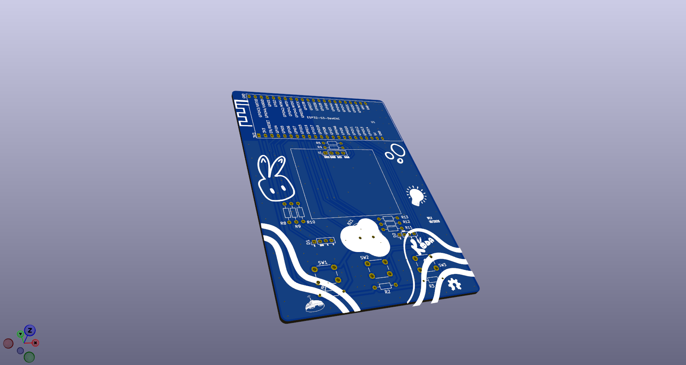

# Kit THT Soldering

  
  
  
  

  Un kit électronique à assembler et à programmer autour d’un <strong>ESP32-S3</strong>. 
  🔧 Assemblez la carte · 💻 Téléversez le firmware · 🎮 Explorez son interface

  

## 🧭 Parcours

Afficher le sommaire

- [🧰 Avant de commencer](#avant-de-commencer)
- [🔥 1. Assembler la carte](#assembler-la-carte)
- [⚙️ 2. Installer Arduino IDE](#installer-arduino-ide)
- [⬆️ 3. Téléverser le firmware](#televerser-le-firmware)
- [🎮 4. Utiliser la carte](#utiliser-la-carte)
- [📖 Guide de jeu](#guide-de-jeu)
- [🛠️ Dépannage](#depannage)
- [📂 Fichiers du projet](#fichiers-du-projet)

## 🧰 Avant de commencer

### 🧪 Matériel

- Le circuit imprimé et les composants indiqués dans la [BOM](kitkodatht.csv).
- Un fer à souder et de l’étain à souder.
- Un câble **USB-C capable de transférer des données** (certains câbles ne servent qu’à la charge).
- Un ordinateur avec Arduino IDE.

| Indispensable | Pratique, mais facultatif |
| --- | --- |
| 🔥 Fer à souder | 🧵 Tresse à dessouder |
| 🧴 Étain à souder | ✨ Flux de soudure |
| 🔌 Câble USB-C avec données | |
| 💻 Ordinateur avec Arduino IDE | |

La tresse à dessouder et le flux peuvent être utiles pour corriger une soudure
ou faciliter le travail, mais ils ne sont pas nécessaires pour assembler le kit.

### 🔎 Repérer les composants

Vérifiez la [BOM à la racine du dépôt](kitkodatht.csv) avant de commencer.
La sérigraphie imprimée sur le PCB indique où placer les composants et leurs
repères (`R1`, `SW1`, etc.). Respectez les valeurs et le sens des composants
polarisés indiqués par la BOM et la sérigraphie.

## 🔥 1. Assembler la carte

> ⚠️ **Sécurité :** ne branchez pas la carte à l’USB pendant la soudure.

1. **📋 Triez** les composants et comparez-les à la [BOM](kitkodatht.csv).
2. **🔎 Repérez** les emplacements grâce aux références sur le PCB. Vérifiez la
   valeur des résistances et l’orientation des composants polarisés.
3. **🔥 Soudez** les composants traversants selon leur contour sur la
   sérigraphie. Pour les composants à plusieurs broches, alignez-les avant de
   souder toutes les broches.
4. **✂️ Nettoyez et inspectez** : coupez les pattes qui dépassent et vérifiez
   qu’il n’y a ni pont d’étain ni broche dessoudée.
5. **✅ Contrôlez** l’absence de débris ou d’excès d’étain pouvant provoquer un
   court-circuit.

> 💡 Le **module ESP32-S3 DevKitC** se connecte au PCB et se programme par son
> port USB-C. Une fois la soudure terminée et inspectée, branchez-le en USB-C
> pour configurer Arduino IDE et téléverser le firmware.

## ⚙️ 2. Installer Arduino IDE

1. Téléchargez et installez [Arduino IDE](https://www.arduino.cc/en/software).
2. **Ajoutez le support de l’ESP32** :
   - Ouvrez **Fichier → Préférences** (Windows/Linux) ou
     **Arduino IDE → Settings/Preferences** (macOS).
   - Dans **URL de gestionnaire de cartes supplémentaires**, ajoutez :
     `https://espressif.github.io/arduino-esp32/package_esp32_index.json`
   - Ouvrez **Outils → Type de carte → Gestionnaire de cartes**, recherchez
     **esp32** et installez **esp32 by Espressif Systems**.
3. **Installez les bibliothèques** depuis **Outils → Gérer les bibliothèques**.
   Recherchez puis installez chacune des bibliothèques indiquées dans
   [`requirements.txt`](requirements.txt) :
   - **Adafruit GFX Library**
   - **Adafruit SH110X**
   - **Adafruit BusIO**

## ⬆️ 3. Téléverser le firmware

1. 🔌 Branchez le module ESP32-S3 au PC avec un câble USB-C de données. Si le
   module est amovible, installez-le sur le PCB avant de le connecter.
2. 📄 Dans Arduino IDE, ouvrez le sketch
   [`firmware/main/main.ino`](firmware/main/main.ino).
3. 🎛️ Dans **Outils → Type de carte**, sélectionnez **ESP32S3 Dev Module**.
   Selon la version du paquet ESP32, **ESP32-S3-DevKitC-1** peut aussi être
   proposé.
4. 🔗 Dans **Outils → Port**, choisissez le port série apparu lors du
   branchement de la carte.
5. ✅ Cliquez sur **Vérifier** pour compiler, puis sur **Téléverser** pour
   envoyer le programme.
   - Si le téléversement reste bloqué sur la connexion, maintenez **BOOT** sur
     le module, lancez le téléversement, puis relâchez BOOT quand la connexion
     commence.
6. 🖥️ Ouvrez le **Moniteur série** et sélectionnez **9600 bauds** pour lire
   les messages de démarrage.

## 🎮 4. Utiliser la carte

Au démarrage, l’écran affiche l’accueil et le buzzer joue une mélodie. Utilisez
les boutons de la carte :

| Bouton | Action |
| --- | --- |
| ⏺️ **Central** | Appui court : sélectionner ou effectuer une action. Appui long : revenir au menu. |
| ◀️ **Gauche** | Parcourir le menu vers la gauche ; dans **Jouer**, jouer à gauche. |
| ▶️ **Droit** | Parcourir le menu vers la droite ; dans **Jouer**, jouer à droite. |

🥚 **Pour commencer :** appuyez au centre pour quitter l’accueil, puis appuyez
quatre fois au centre pour faire éclore l’œuf. Utilisez ensuite gauche et droite
pour parcourir le menu. Un appui court au centre ouvre l’écran sélectionné ;
un appui long au centre revient au menu depuis une activité ou un écran de
statistiques.

## 📖 Guide de jeu

### Comprendre les boutons

| Commande | Action |
| --- | --- |
| ◀️ Gauche / ▶️ Droit dans le menu | Parcourir les pages du menu. |
| ⏺️ Appui court au centre | Ouvrir une page, effectuer une action ou fermer une fenêtre. |
| ⏺️ Appui long au centre | Revenir au menu depuis une activité ou les statistiques. |
| ◀️ + ▶️ dans **Jouer** | Jouer du côté gauche, du côté droit ou des deux côtés simultanément. |

### Activités et récompenses

- **Apprendre :** après une seconde, une anecdote éducative apparaît. Un appui
  court la ferme ; l’appui suivant affiche une autre anecdote. Chaque appui
  dans cette activité compte comme une leçon : environ **5 leçons** donnent
  **1 point de culture** et chaque leçon rapporte **2 pièces**.
- **Jouer :** appuyez sur gauche, droite ou les deux boutons latéraux. Chaque
  action compte comme une partie ; environ **50 parties** donnent **1 point de
  bonheur**.
- **Expérimenter :** l’activité lance une recherche des réseaux Wi-Fi proches.
  La fenêtre de résultat indique les réseaux trouvés et la créativité gagnée.
  Chaque réseau contribue à la créativité ; le talent du compagnon peut faire
  varier légèrement la progression. Chaque tranche de **4 réseaux trouvés dans
  une recherche** rapporte **1 pièce**. Fermez le résultat avec le bouton
  central ; un nouvel appui lance une autre recherche.
- **Nourrir :** un repas coûte **15 pièces**. Appuyez trois fois au centre pour
  manger la pomme ; le compagnon gagne jusqu’à **3 points de faim**, sans
  dépasser le maximum de **5**. Le résultat indique le gain réel. Un compagnon
  déjà rassasié ne peut pas manger.

Les talents sont légèrement aléatoires : les seuils de culture et de bonheur
peuvent donc varier de quelques actions d’un compagnon à l’autre.

### Argent, faim et santé

- Le moyen le plus régulier de gagner de l’argent est **Apprendre** :
  **2 pièces par leçon**. L’expérimentation peut aussi rapporter une pièce par
  tranche de quatre réseaux trouvés pendant une recherche.
- La faim commence à **5** et baisse d’un point toutes les **5 minutes**. Le
  compagnon prend également un an toutes les 5 minutes.
- La santé est comprise entre **0 et 5**. Si la faim vaut **0**, la santé baisse
  d’un point toutes les 5 minutes. Si la faim vaut **5** au moment d’une mise à
  jour, la santé remonte d’un point ; avec toute autre valeur, elle ne change
  pas.
- À **0 santé**, le compagnon meurt. La mélodie de défaite est jouée, puis une
  nouvelle partie commence avec un nouvel œuf.

### Code secret

Sur la page **Animal** du menu, appuyez simultanément sur les trois boutons
(gauche, centre et droit) pour tuer instantanément le compagnon. La mélodie de
défaite joue, puis le jeu recommence avec un nouvel œuf.

## 🛠️ Dépannage

- 🔌 **La carte n’apparaît pas dans la liste des ports :** essayez un autre câble
  USB-C (avec données), un autre port USB ou installez le pilote USB adapté à
  votre module.
- ⬆️ **Le téléversement ne démarre pas :** vérifiez la carte et le port
  sélectionnés, puis essayez la procédure avec le bouton BOOT décrite plus haut.
- 📚 **La compilation échoue sur une bibliothèque :** installez ou mettez à jour
  les trois bibliothèques Adafruit indiquées dans
  [`requirements.txt`](requirements.txt).
- 🖥️ **L’écran reste vide ou un composant ne répond pas :** débranchez l’USB,
  vérifiez la BOM, l’orientation et les soudures, puis rebranchez la carte.
- 📟 **Le moniteur série affiche des caractères illisibles :** sélectionnez
  **9600 bauds**.

## 📂 Fichiers du projet

- [`kitkodatht/`](kitkodatht/) — schéma, PCB et projet KiCad.
- [`kitkodatht.csv`](kitkodatht.csv) — BOM de référence du kit.
- [`firmware/main/`](firmware/main/) — firmware Arduino.
- [`visuels/pcb.png`](visuels/pcb.png) — aperçu du PCB.

---

  <strong>🧡 Bon assemblage et bon amusement !</strong> 
  Un doute ? Vérifiez d’abord la BOM et la sérigraphie avant de mettre la carte sous tension.

